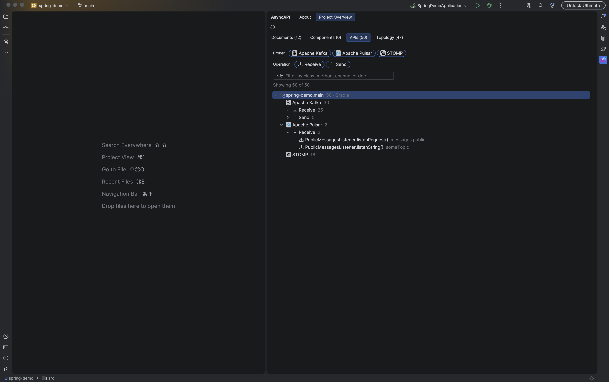
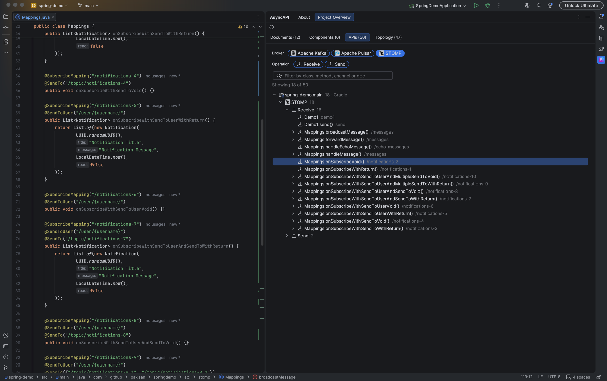
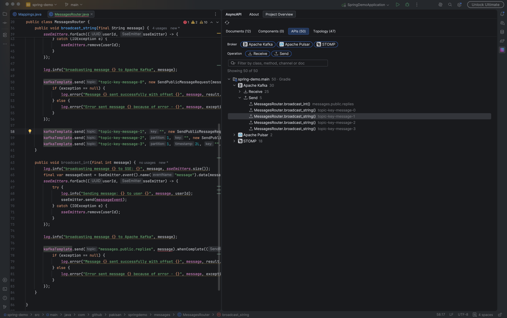
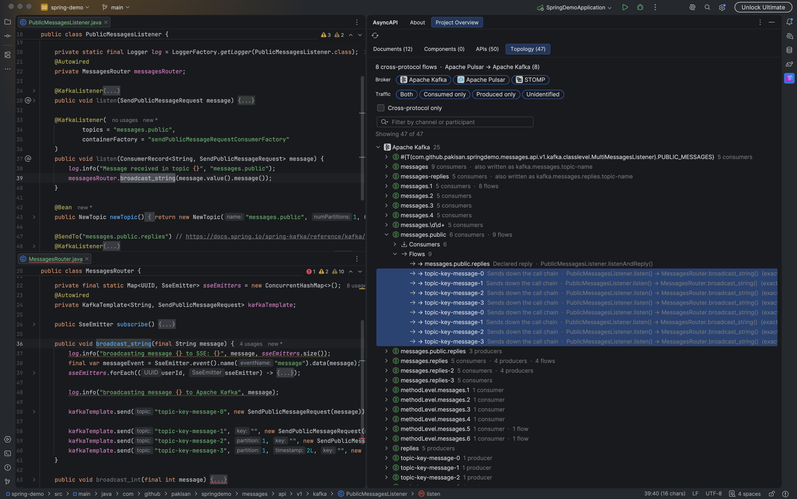
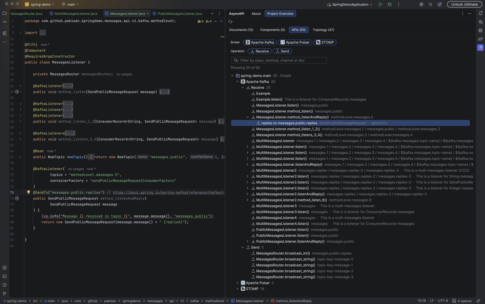
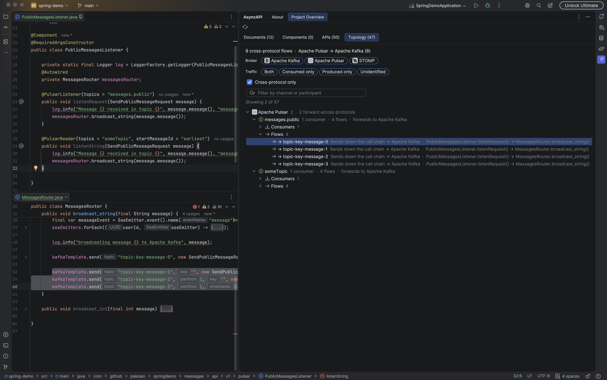

# How the AsyncAPI Plugin Helps Spring Engineers in IntelliJ IDEA

The [AsyncAPI plugin](https://plugins.jetbrains.com/plugin/15673-asyncapi) for JetBrains IDEs now understands Spring Messaging. It automatically discovers, visualizes, and inspects your event-driven code across 
`Amazon SNS`, `Amazon SQS`, `Apache Kafka`, `Apache Pulsar`, `RabbitMQ`, `JMS`, and `STOMP` right inside IntelliJ IDEA

These features are implemented trough [IntelliJ SDK](https://plugins.jetbrains.com/docs/intellij/welcome.html), so no compiled or running application required. They work the same whether you're on IntelliJ IDEA Community or Ultimate

Here's what it brings to your day-to-day work with Spring and messaging

## Project Overview

This is the most valuable feature since day one. It doesn't matter you are working on a project, that grew too fast or one you inherited from someone else. Every newly added channel, operation or protocol will be discovered automatically

> You run your Spring Boot app and... "Wait, which APIs does this thing even expose?!"

{: width="972" height="589" }

Project Overview scans every module in your project and puts your whole event-driven surface in one place

### Message handlers and listeners

The plugin collects and visualizes messaging endpoints across your codebase, so you can see your event-driven architecture at a glance instead of searching for annotations by hand

{: width="972" height="589" }

#### Amazon SNS

```java
@NotificationMessageMapping   // on a plain @Service, not a @RestController/@Controller
public void onOrder(@NotificationMessage Order order) {
    // some logic
}
```

#### Amazon SQS

```java
@SqsListener("orders-queue")
public class Handlers {

    @SqsHandler(isDefault = true) 
    public void a(Order o) {
        // some logic
    }

    @SqsHandler(isDefault = true)
    public void b(Refund r) {
        // some logic
    }

}
```

#### Apache Kafka

```java
@KafkaListener(topics = "orders.placed", groupId = "billing")
public void onOrderPlaced(Order order) {
    // some logic
}
```

#### Apache Pulsar

```java
@PulsarReader(topics = "orders", startMessageId = "somewhere")
public void onOrder(Order order) {
    // some logic
}
```

#### JMS

```java
@JmsListener(destination = "orders-queue", selector = "(type = 'ORDER'")
public void onOrder(Order order) {
    // some logic
}
```

#### STOMP

```java
@MessageMapping("/chat")
@SendTo("/topic/messages")
public OutputMessage send(Message message) throws Exception {
    String time = new SimpleDateFormat("HH:mm").format(new Date());
    return new OutputMessage(message.getFrom(), message.getText(), time);
}
```

Endpoints are attributed to the right module and broker for both `Gradle` and `Maven` source sets, and are searchable by class, method, or Javadoc.

Every row links straight to its method or class in the editor. It stays fast on projects with hundreds of listeners

### Message publishing

{: width="972" height="589" }

The plugin finds every place where your code publishes messages
- `KafkaTemplate`
- `RabbitTemplate` / `AmqpTemplate`
- `JmsTemplate` / `JmsMessagingTemplate`
- `PulsarTemplate`
- `SqsTemplate`
- `SnsTemplate`
- `SimpMessagingTemplate` (STOMP) 

and reports the destination reported exactly as written in your code

### Messaging Topology: linking producers to consumers

Project Overview links senders to the listeners that consume the same channel, and lays the whole picture out as a topology. A listener and a sender that name the same channel differently — a literal on one side, a `${property}` placeholder or an `@Value`-injected field on the other are recognized as the same channel

The project is laid out by channel instead of by code: 
- producers
- consumers

and the flows between them, readable hop by hop across module boundaries, plus a traffic view for channels your project only consumes or only publishes

It also covers hidden publishes - a listener that publishes further down its own call chain (through a service, a port, an interface) is found automatically and marked as an inferred route, kept visibly distinct from a route the code declares directly

{: width="972" height="589" }

#### Send and receive directions

Every module and broker splits into `Receive` and `Send`, with a dedicated Operation filter to narrow the tree to one direction

#### Replies

Listener that answers on another channel (`@SendTo`, or a reply-to header on RabbitMQ and JMS) is shown right next to the listener that produces it

{: width="972" height="589" }

### Cross-protocol messaging

Listeners or handlers which are forwarding messages from one protocol to another

For example, an Apache Pulsar listener that receives messages from `messages.public` channel and forwards them to Apache Kafka `topic-key-message-*` channels

{: width="972" height="589" }

## Code inspections

No more annoyed application startup exceptions when your forget to add `@KafkaHandler` in your `@KafkaListener` class

```java
@KafkaListener(topics = "my-topic")
public class Example {

    public void listen(ConsumerRecords<String, SendPublicMessageRequest> records) {}

}
```

Or undefined behavior when several `@KafkaListener` are working with same topic and consumerGroup

```java
@KafkaListener(topics = "orders", groupId = "orders-service")
public void handleOrder(Order order) {}

// elsewhere in the project
@KafkaListener(topics = "orders", groupId = "orders-service")
public void handleOrderAudit(Order order) {}
```

Number of available inspections for supported protocols:
- `Amazon SNS` - 6 checks
- `Amazon SQS` - 14 checks
- `Apache Kafka` - 13 checks
- `Apache Pulsar` - 8 checks
- `JMS` - 5 checks

## Export

Project Overview finds your messaging code and export turns it into an [AsyncAPI](https://www.asyncapi.com) document - one per environment, for `Apache Kafka`, `Apache Pulsar`, `Amazon SQS`, `Amazon SNS`, and `JMS`

Bindings, topic and queue names, FIFO detection, and dedup settings are read from what the code actually does, not typed in by hand and left to drift

Even cross-protocol message forwarding will be exported

```json
{
  "operations" : {
    "receive_SendPublicMessageRequest_from_messages.public": {
      "action": "receive",
      "channel": {
        "$ref": "#/channels/messages.public"
      },
      "title": "PublicMessagesListener.listenRequest()",
      "messages": [
        {
          "$ref": "#/channels/messages.public/messages/com.github.pakisan.springdemo.messages.api.v1.dto.SendPublicMessageRequest"
        }
      ],
      "x-forwards-to": [
        {
          "operation": "#/operations/send_SendPublicMessageRequest_to_topic-key-message-0",
          "channel": "#/channels/topic-key-message-0",
          "protocol": "kafka",
          "via": "call-chain",
          "confidence": "exact",
          "path": [
            "PublicMessagesListener.listenRequest()",
            "MessagesRouter.broadcast_string()"
          ]
        }
      ]
    }
  }
}
```

---

## ❤️ Thanks for Your Support

A huge thank you to everyone who has tried the plugin, reported issues, shared feedback, or spread the word.
Your support directly shapes where this project goes next.

Have ideas, questions, or feature requests? Drop me a message - I'm always happy to chat.
